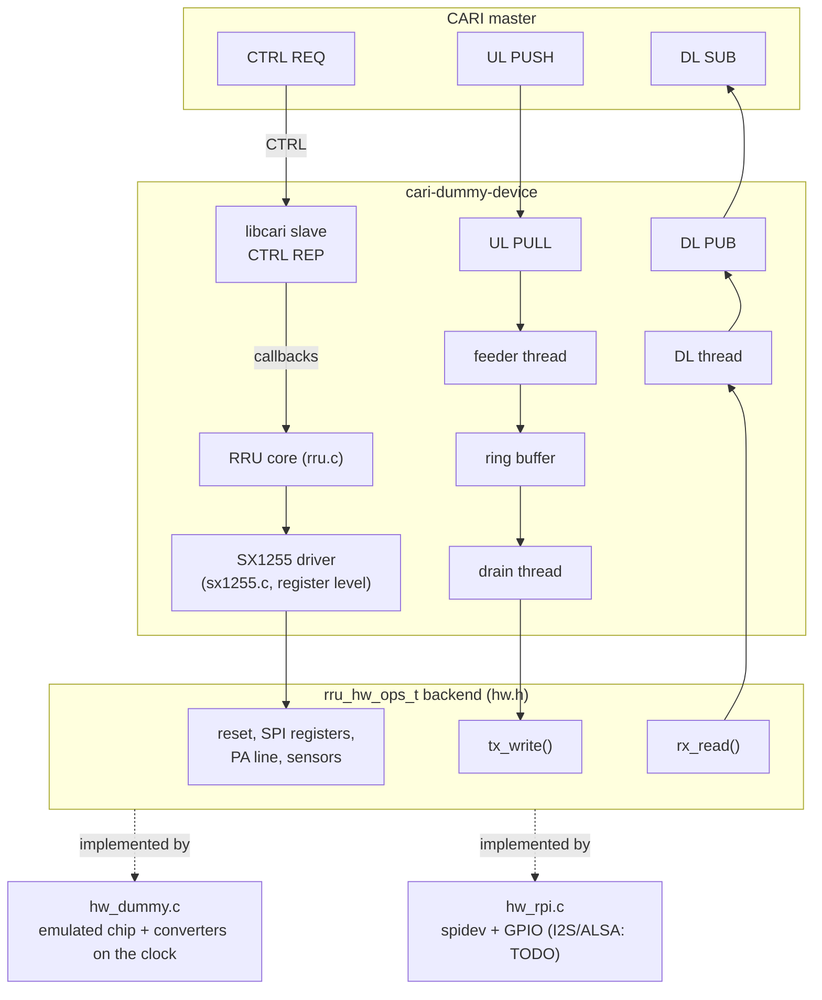

# cari-dummy-device

CARI 2.1 slave that emulates the planned **M17 SX1255 RRU** (Raspberry Pi + Semtech SX1255 with a 32 MHz crystal, I2S samples, SPI control). Register settings follow [libsx1255](https://github.com/M17-Project/libsx1255). Use it to develop and test CARI masters without hardware. It is built on [libcari](https://github.com/M17-Project/libcari) and supports [CARI 2.1](https://github.com/M17-Project/CARI/blob/main/docs/commands.md).

## What it presents

One subdevice (0), full duplex, I/Q only:

| | Value |
|---|---|
| Subdevice capabilities | reset, I/Q, RX, TX, full duplex, CS16 |
| RX / TX frequency | 400..510 MHz |
| Sample rate | 125, 250, 500 kHz |
| LNA gain | 0, 12, 24, 36, 42, 48 dB |
| Output power | -34 .. +5 dBm, 1 dB steps, value read back quantized |
| Device capabilities | compression (FLAC), supervision |
| Supervision | temperature, voltage, current, RL, incident and reflected power |
| Frequency correction | ±100 ppm, applied to the crystal in the frequency words |

Parameters not listed (channel width, AGC, AFC, DC correction, deviation) return status 2.

## Architecture



## Build and run

```sh
git clone --recursive https://github.com/M17-Project/cari-dummy-device
cd cari-dummy-device
cmake -S . -B build
cmake --build build
./build/cari-dummy-device -v
```

libcari comes as a git submodule in `libcari/` and is linked statically, so the installed program needs nothing else from libcari.

```
  -c, --ctrl=PORT|EP     CTRL REP port or ZMQ endpoint (default 17002)
  -b, --bind=HOST        data-plane bind address (default * = all interfaces)
  -i, --ident=STR        IDENT string
  -x, --xtal=HZ          SX1255 crystal (default 32e6)
  -P, --pmax=DBM         output power at full TX gain (default 5.0)
  -g, --pga=CODE         RX PGA gain code 0..15 (default 15 = +6 dB)
  -t, --period=MS        DL message period (default 10)
      --ul-period=US     UL drain period (default 1000)
  -u, --ul-buffer=MS     UL ring buffer (default 60)
  -p, --prefill=MS       UL samples buffered before keying (default 0 = automatic)
      --jitter=MS        jitter margin of the automatic prefill (default 5)
      --ul-rcvbuf=BYTES  UL socket receive buffer (default 32768)
  -f, --freq=HZ          default RX/TX frequency (default 433475000)
  -H, --hw=NAME          dummy (default) or rpi (skeleton)
  -v, --verbose          -v info, -vv debug, -vvv SPI trace
```

User registers: `0x02` backend (0 dummy, 1 rpi, read-only), `0x80..0x93` mirror SX1255 registers 0x00..0x13 (read-only) - e.g. `cari-ctrl reg 0x87` reads the chip version 0x11.

A subdevice reset (action 0x00) pulses the chip reset and reprograms the current settings. A device reset (write to register 0x00) restores the defaults: 433.475 MHz, 250 kHz, LNA 48 dB (highest), −10 dBm, compression off.

## Tests

```sh
ctest --test-dir build
```

- `test_sx1255` - datasheet values and encodings (frequency word, LNA/TX gain tables, rate/divider search, register writes).
- `test_ring` - UL ring buffer (wrap, blocking writes, wake-ups).
- `test_latency` - RRU core in-process: with the end marker, every sample sent is played (counted exactly) and no trip occurs, for real-time and ahead-of-time masters. With masters sending 1/2/5/10/20 ms messages in real time: key-up delay against the prefill model, no trip while the master keeps up (a session is retried once, because shared VMs stall threads for tens of milliseconds), and immediate keying for a master that is ahead.
- `test_e2e` - spawns the device and drives it with libcari: the advertised profile, parameter rules and quantization, the SX1255 registers behind each parameter, DL measured at 125/250/500 kHz (±3 %), FLAC DL, UL backpressure and trip timing (the trip arrives when the sent samples have been played at the sample rate, e.g. 1.0 s of samples: trip after 1.01 s), trip/clear/start-refused rules, FLAC UL, full duplex at 500 kHz with supervision (incident power = set power + 20*log10|x|), resets and clean shutdown.
